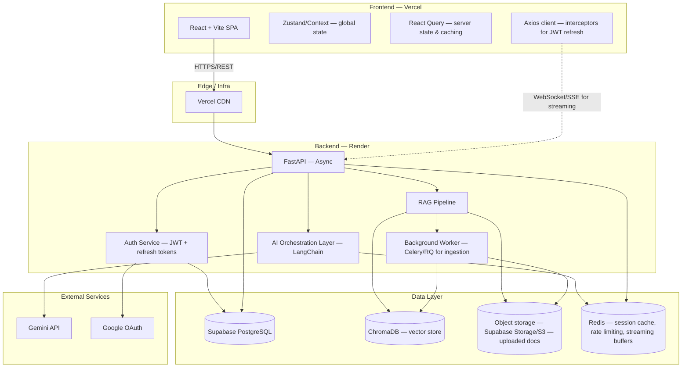
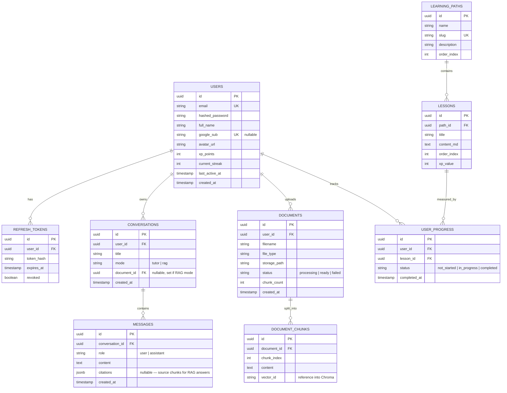
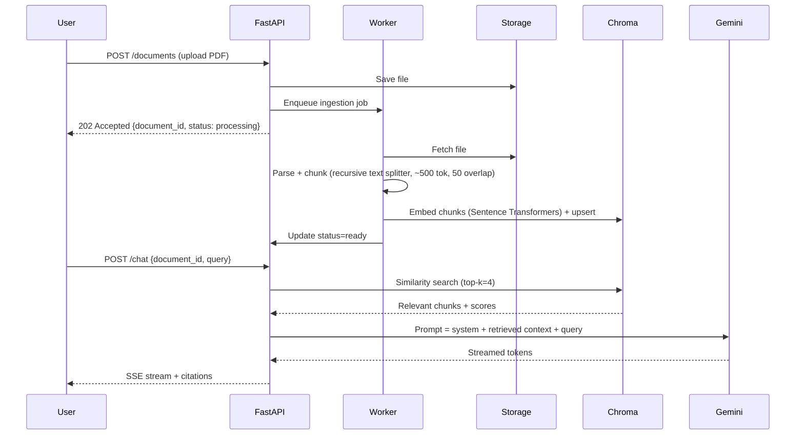

# AI/ML Learning Tutor — Phase 1: Architecture

## 0. Scope reality check (read this first)

Before diving in — 15 modules with voice mock interviews, RAG, a code playground, and a full gamification engine is not a weekend project. It's a 6–10 week build even scoped tightly. That's fine — it's exactly what makes it a strong resume project — but building it well beats building it fast. My recommendation, which this architecture is designed around:

**Build a strong vertical slice first, wire it end-to-end, deploy it, then layer modules on top.**

Core slice (Phases 2–6 as originally requested):
- Auth (JWT, email+password — Google OAuth as a fast-follow, not blocking)
- Dashboard (real data, not mock)
- AI Tutor (streaming, context memory)
- Document Learning / RAG (this is your strongest differentiator — you already built DocuMind AI, so this reuses real expertise)
- One Learning Path fully fleshed out end-to-end (proves the pattern for the rest)

Everything else (Quiz Generator, Resume Analyzer, Interview Prep, Project Generator, Admin Panel, etc.) plugs into the same architecture as additional modules later — I'm designing the schema and API structure now so none of them require rework when added.

I'll wait for your go-ahead before Phase 2 (Backend), as instructed.

---

## 1. System Architecture (high level)



**Why this shape:**
- **Async FastAPI** everywhere I/O-bound (DB calls, Gemini calls, vector search) — this is a real interview talking point (event loop, non-blocking I/O vs thread-per-request).
- **Background worker for ingestion** — parsing a 200-page PDF and generating embeddings synchronously inside a request handler will time out on Render's free/hobby tier and blocks the event loop. Ingestion is queued, and the frontend polls or listens via SSE for "ready" status. This is the single biggest thing that separates a toy RAG demo from a "production-ready" one — mention this explicitly in your resume bullet.
- **Redis** is doing double duty: rate limiting (protects your Gemini API quota/budget) and a pub/sub layer for streaming token buffers if you outgrow plain SSE from FastAPI directly.
- **Chroma** runs embedded (local persistent dir) for dev, and as a hosted/managed instance (Chroma Cloud or a small Render disk-backed service) in prod — call this out in your docs as a scaling decision, not an oversight.

---

## 2. Database Schema (Phase-1-relevant tables only)



Notes on decisions worth defending in an interview:
- **`token_hash` not raw refresh token** — never store bearer tokens in plaintext, even in your own DB.
- **`citations` as jsonb on messages** — lets the RAG tutor show "answered from page 4, paragraph 2" in the UI without a join, and keeps the message table schema-flexible for future modes (quiz feedback, code review feedback) without new tables.
- **`vector_id` is a pointer, not the embedding itself** — Postgres stores metadata/relationships, Chroma stores vectors. Don't duplicate embeddings into Postgres; keeps your relational DB lean and your vector store swappable later (Chroma → pgvector → Pinecone) without touching the app schema.

---

## 3. RAG Pipeline (Module 5 — your strongest module)



Key engineering point to highlight on your resume: **the tutor is instructed to answer only from retrieved context and to say "not found in document" when similarity scores fall below a threshold** — this is the difference between a RAG demo and a RAG system that doesn't hallucinate silently.

---

## 4. API Surface (Phase-1 slice)

All routes versioned under `/api/v1`. Every endpoint gets: Pydantic request/response schemas, structured logging (request id, user id, latency), and consistent error envelope.

```
POST   /api/v1/auth/signup
POST   /api/v1/auth/login
POST   /api/v1/auth/refresh
POST   /api/v1/auth/google
POST   /api/v1/auth/forgot-password
GET    /api/v1/users/me
PATCH  /api/v1/users/me

GET    /api/v1/dashboard/summary

GET    /api/v1/paths
GET    /api/v1/paths/{slug}/lessons
GET    /api/v1/lessons/{id}
POST   /api/v1/lessons/{id}/complete

POST   /api/v1/conversations
GET    /api/v1/conversations
GET    /api/v1/conversations/{id}/messages
POST   /api/v1/conversations/{id}/messages   # SSE stream response

POST   /api/v1/documents                     # multipart upload
GET    /api/v1/documents/{id}                # poll status
GET    /api/v1/documents
```

Error envelope (consistent across every endpoint):
```json
{
  "error": {
    "code": "VALIDATION_ERROR",
    "message": "email already registered",
    "field": "email"
  }
}
```

---

## 5. Folder Structure

```
aiml-learning-tutor/
├── frontend/
│   ├── src/
│   │   ├── components/       # reusable, dumb components
│   │   ├── features/         # feature-sliced: auth/, dashboard/, tutor/, rag/, paths/
│   │   ├── hooks/
│   │   ├── lib/               # axios instance, query client
│   │   ├── stores/             # zustand stores
│   │   ├── routes/
│   │   └── types/
│   ├── vite.config.ts
│   └── package.json
│
├── backend/
│   ├── app/
│   │   ├── api/v1/            # routers only — thin controllers
│   │   ├── core/               # config, security, logging
│   │   ├── models/             # SQLAlchemy ORM models
│   │   ├── schemas/            # Pydantic
│   │   ├── services/           # business logic (auth_service, rag_service, ai_service)
│   │   ├── repositories/       # DB access layer (keeps services test-friendly)
│   │   ├── workers/            # background job definitions
│   │   └── main.py
│   ├── alembic/                # migrations
│   ├── tests/
│   └── requirements.txt
│
├── database/
│   └── migrations/             # tracked separately for docs clarity
│
├── docs/
│   ├── PHASE_1_ARCHITECTURE.md (this file)
│   ├── api/                    # OpenAPI/Swagger export
│   └── diagrams/
│
└── README.md
```

**Why `services/` + `repositories/` split:** routers call services (business logic), services call repositories (DB queries). This is the dependency-injection-friendly pattern FastAPI is built for — `Depends()` injects a repository or service into a route — and it's exactly the layering interviewers probe for when they ask "how did you structure this."

---

## 6. Non-functional decisions worth stating up front

| Concern | Decision |
|---|---|
| Rate limiting | Redis-backed sliding window per user, protects Gemini quota |
| Pagination | Cursor-based on list endpoints (conversations, documents) — mention this over offset pagination, it's the more senior answer |
| Secrets | `.env` locally, Render/Vercel environment variables in prod, never committed |
| Logging | Structured JSON logs (request id, user id, latency, status) via `structlog` |
| Migrations | Alembic, one migration per schema change, never hand-edit prod DB |
| Testing | Pytest for backend services/repositories; Vitest + React Testing Library for frontend |

---

## Next: Phase 2 (Backend)

When you're ready, say so and I'll build out the actual FastAPI backend for this core slice — models, Alembic migrations, auth service with JWT, the RAG ingestion worker, and the streaming chat endpoint — as real, runnable code with a requirements.txt, not pseudocode.
